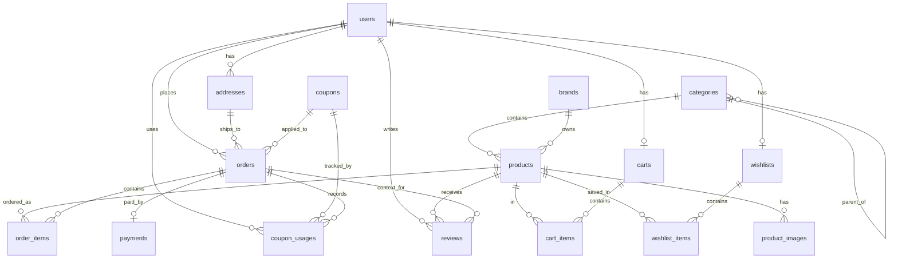

# Database ERD & Schema Documentation

Database: **MySQL** (recommended) / SQLite supported for local development.  
All monetary values use `DECIMAL(12,2)`. Timestamps included on core tables. Soft deletes used where appropriate.

## Entity Relationship Overview

## Tables

### 1. users
Stores admin and customer accounts.
- `id` PK
- `name`, `email` (unique), `phone` (nullable), `avatar` (nullable)
- `role` (`admin` | `customer`, indexed)
- `is_active` (bool)
- `email_verified_at`, `password`, `remember_token`
- `timestamps`, `softDeletes`

### 2. categories
Product categories (supports optional parent for hierarchy).
- `id` PK
- `name`, `slug` (unique), `description`, `image`
- `parent_id` FK -> `categories.id` (nullable, null on delete)
- `is_active` (indexed), `sort_order`
- `timestamps`, `softDeletes`

### 3. brands
Product brands.
- `id` PK
- `name`, `slug` (unique), `logo`, `description`
- `is_active` (indexed)
- `timestamps`, `softDeletes`

### 4. products
Catalog products.
- `id` PK
- `category_id` FK -> `categories.id` (cascade delete)
- `brand_id` FK -> `brands.id` (nullable, null on delete)
- `name`, `slug` (unique), `sku` (unique)
- `short_description`, `description`
- `price` DECIMAL(12,2), `sale_price` DECIMAL(12,2, nullable)
- `stock_quantity`, `low_stock_threshold`
- `thumbnail`, `is_active`, `is_featured`
- `timestamps`, `softDeletes`
- Indexes: `(category_id, is_active)`, `is_active`, `is_featured`

### 5. product_images
Additional product images.
- `id` PK
- `product_id` FK -> `products.id` (cascade delete)
- `image_path`, `alt_text`, `sort_order`, `is_primary`
- `timestamps`

### 6. carts
One cart per authenticated user.
- `id` PK
- `user_id` FK -> `users.id` (unique, cascade delete)
- `timestamps`

### 7. cart_items
Items in a cart.
- `id` PK
- `cart_id` FK -> `carts.id` (cascade delete)
- `product_id` FK -> `products.id` (cascade delete)
- `quantity`
- `timestamps`
- Unique: `(cart_id, product_id)`

### 8. wishlists
One wishlist per authenticated user.
- `id` PK
- `user_id` FK -> `users.id` (unique, cascade delete)
- `timestamps`

### 9. wishlist_items
Saved wishlist products.
- `id` PK
- `wishlist_id` FK -> `wishlists.id` (cascade delete)
- `product_id` FK -> `products.id` (cascade delete)
- `timestamps`
- Unique: `(wishlist_id, product_id)`

### 10. addresses
Customer shipping addresses.
- `id` PK
- `user_id` FK -> `users.id` (cascade delete)
- `label`, `recipient_name`, `phone`
- `line1`, `line2`, `city`, `state`, `postal_code`, `country`
- `is_default` (indexed)
- `timestamps`
- Index: `(user_id, is_default)`

### 11. orders
Customer orders with shipping snapshot.
- `id` PK
- `user_id` FK -> `users.id` (cascade delete)
- `address_id` FK -> `addresses.id` (nullable, null on delete)
- `order_number` (unique)
- `status` (indexed), `payment_status` (indexed)
- `subtotal`, `discount_amount`, `shipping_fee`, `total` DECIMAL(12,2)
- `coupon_id` FK -> `coupons.id` (nullable, null on delete), `coupon_code`
- Shipping snapshot: `shipping_name`, `shipping_phone`, `shipping_line1`, `shipping_line2`, `shipping_city`, `shipping_state`, `shipping_postal_code`, `shipping_country`
- `notes`, `placed_at`, `cancelled_at`
- `timestamps`, `softDeletes`
- Index: `(user_id, status)`

### 12. order_items
Line items with purchase-time price snapshots.
- `id` PK
- `order_id` FK -> `orders.id` (cascade delete)
- `product_id` FK -> `products.id` (nullable, null on delete)
- `product_name`, `sku`, `quantity`
- `unit_price`, `total_price` DECIMAL(12,2)
- `timestamps`
- Index: `(order_id, product_id)`

### 13. payments
Payment records per order.
- `id` PK
- `order_id` FK -> `orders.id` (cascade delete)
- `payment_method` (`khqr` | `cod`)
- `status` (`pending` | `paid` | `failed` | `cancelled` | `refunded`, indexed)
- `amount` DECIMAL(12,2), `currency`
- `transaction_id` (unique, nullable), `provider_reference` (indexed)
- `qr_payload` (text), `meta` (json)
- `paid_at`, `failed_at`
- `timestamps`
- Index: `(order_id, status)`

### 14. coupons
Discount coupons.
- `id` PK
- `code` (unique), `type` (`fixed` | `percent`), `value` DECIMAL(12,2)
- `min_order_amount`, `max_discount_amount` (nullable)
- `usage_limit`, `used_count`, `per_user_limit`
- `starts_at`, `expires_at`, `is_active` (indexed)
- `timestamps`

### 15. coupon_usages
Tracks coupon usage per user/order.
- `id` PK
- `coupon_id` FK -> `coupons.id` (cascade delete)
- `user_id` FK -> `users.id` (cascade delete)
- `order_id` FK -> `orders.id` (cascade delete)
- `discount_amount` DECIMAL(12,2), `used_at`
- `timestamps`
- Index: `(coupon_id, user_id)`

### 16. reviews
Product reviews and ratings.
- `id` PK
- `user_id` FK -> `users.id` (cascade delete)
- `product_id` FK -> `products.id` (cascade delete)
- `order_id` FK -> `orders.id` (nullable, null on delete)
- `rating` (1-5), `title`, `comment`
- `is_approved` (indexed)
- `timestamps`, `softDeletes`
- Index: `(product_id, is_approved)`

### 17. banners
Homepage/promotional banners.
- `id` PK
- `title`, `subtitle`, `image_path`, `link_url`
- `position` (indexed), `sort_order`
- `is_active` (indexed), `starts_at`, `expires_at`
- `timestamps`

### 18. notifications
Laravel database notifications table.
- `id` UUID PK
- `type`, `notifiable_type`, `notifiable_id` (morphs)
- `data` (text/json), `read_at` (nullable)
- `timestamps`

## Relationships Summary

- **User** has many Addresses, Orders, Reviews, CouponUsages; has one Cart, one Wishlist.
- **Category** has many Products; belongs to optional parent Category.
- **Brand** has many Products.
- **Product** belongs to Category and Brand; has many ProductImages, Reviews, OrderItems.
- **Cart/Wishlist** belong to User and have many Items.
- **Order** belongs to User, Address, Coupon; has many OrderItems; has one Payment and one CouponUsage.
- **Payment** belongs to Order.
- **Coupon** has many CouponUsages and Orders.

## Business Rules Reflected in Schema/Logic

- Order item prices are snapshotted at purchase time (`product_name`, `sku`, `unit_price`, `total_price`).
- Stock is validated and decremented during checkout transaction; restored on eligible cancellations.
- Totals/discounts are calculated on backend; frontend does not determine final pricing authority.
- Payment status is tracked separately and only marked paid after explicit verification (mock mode) or official live verification integration.
